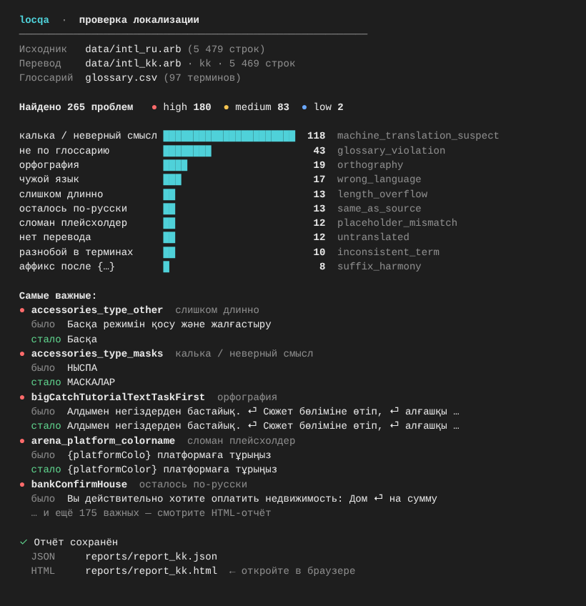

# locqa — контроль качества ARB-локализации

📊 **Презентация:** `presentation.pdf` (передана организаторам в архиве; в репозиторий не кладём — на слайдах примеры строк игры) — 10 слайдов: проблема, решение, CLI `locqa`, результаты (265 находок, 270 проверенных исправлений), примеры ошибок

📄 **Методология:** [METHODOLOGY.md](METHODOLOGY.md)

Находит ошибки в переводах Flutter (`.arb`) относительно исходного языка и помогает
собрать исправленный файл, где каждая правка проверена человеком.

## Что сдаём

| Требование кейса | Файл |
|---|---|
| CLI `locqa check …` + report.json + HTML | `locqa`, `locqa.py`, `reports/report_kk.json`, `reports/report_kk.html` (+ веб-интерфейс в `web/`) |
| glossary.csv (ru, kk, en + комментарий) | `glossary.csv` — 97 терминов, плюс колонки `uz`, `kk_wrong`, `enforce`, `keep` |
| intl_kk_fixed.arb с отметкой проверки человеком | `intl_kk_fixed.arb` — 270 изменённых строк, все проверены носителем |
| Методология | **`METHODOLOGY.md`** — как искали, как исправляли, сколько строк прошло через носителя |
| Презентация | `presentation.pdf` — в архиве для организаторов (не в репозитории) |
| Бонус: узбекский | `reports/report_uz.*`, `reports/review_uz.csv`, `reports/intl_uz_fixed_DRAFT.arb` (ждёт носителя узбекского) |
| Бонус: GitHub Action | `.github/workflows/locqa.yml` |
| Бонус: переформулировка аффиксов | `suggestion` у находок `suffix_harmony` |
| Бонус: латиница (алфавит 2021) с проверкой длины | `locqa translit` → `reports/intl_kk_latn.arb` |

## Структура папки

```text
locqa/
├── locqa, locqa.py          # инструмент (CLI); двойной клик по locqa — меню
├── glossary.csv             # глоссарий: ru, kk, en, uz, комментарий, kk_wrong, enforce
├── intl_kk_fixed.arb        # ИТОГ: исправленный казахский файл (проверен носителем)
├── README.md                # документация
├── METHODOLOGY.md           # методология (для жюри)
├── examples/                # синтетический пример со всеми 11 типами ошибок (не данные игры)
├── tests/                   # 26 автотестов
├── .github/workflows/       # GitHub Action: тесты + проверка ARB на каждый pull request
├── docs/                    # скриншот терминала (presentation.pdf — только локально, не в репозитории)
├── web/                     # бонус: веб-интерфейс участника команды
├── data/                    # исходные ARB от организаторов (в git не попадает)
└── reports/                 # отчёты, таблицы и страницы проверки (в git не попадает)
```

## Попробовать без данных игры

```bash
./locqa check --source examples/intl_ru.arb --target examples/intl_kk.arb --glossary glossary.csv --out report_example.json
```

В примере 18 строк, и в каждой своя типичная ошибка — инструмент находит все 11 типов из задания.

## Установка

Зависимостей нет, нужен только Python 3.9+. Запускать можно тремя способами:

```bash
./locqa check ...            # запускатель из папки проекта (Mac/Linux)
python3 locqa.py check ...   # то же самое
pip install . && locqa check ...   # установить команду locqa в систему
```

## Быстрый старт

```bash
# 1. Проверка → report_kk.json + report_kk.html
./locqa check --source data/intl_ru.arb --target data/intl_kk.arb \
    --glossary glossary.csv --include reports/llm_findings_kk.json \
    --out reports/report_kk.json

# 2. Таблица для носителя языка (для intl_kk уже готова — reports/review_kk.csv;
#    существующий файл команда не перезапишет без --force)
./locqa review-sheet --report reports/report_kk.json --out reports/review_kk.csv

# 3. Носитель открывает review_kk.csv (Excel / Google Sheets), заполняет
#    kk_final (итоговый текст) и reviewer (своё имя). Пустой kk_final = не менять.

# 4. Сборка исправленного файла + отметка проверенных находок в отчёте
./locqa apply --target data/intl_kk.arb --review reports/review_kk.csv \
    --out intl_kk_fixed.arb --report reports/report_kk.json

# 5. Проверка совместимости с flutter gen-l10n
./locqa validate intl_kk_fixed.arb --template data/intl_ru.arb
```

Узбекский — та же команда с `--target data/intl_uz.arb`.
Вывод в терминале цветной (сводка по типам, самые важные находки); `--no-color` или `NO_COLOR=1` — без цветов.



Пример вывода `check`:

```
  locqa  ·  проверка локализации
  ──────────────────────────────────────────────────────────
  Исходник   data/intl_ru.arb (5 479 строк)
  Перевод    data/intl_kk.arb · kk · 5 469 строк
  Глоссарий  glossary.csv (97 терминов)

  Найдено 265 проблем   ● high 180  ● medium 83  ● low 2

  калька / неверный смысл ██████████████████████  118  machine_translation_suspect
  не по глоссарию         ████████                 43  glossary_violation
  орфография              ████                     19  orthography
  ...
  ✓ Отчёт сохранён
    HTML     reports/report_kk.html  ← откройте в браузере
```
Тесты: `python3 -m pytest tests` (26 тестов). Для `--llm` нужен `pip install anthropic`.

## Что проверяется

| Тип | Как ищем |
|---|---|
| `untranslated` | ключа нет или перевод пустой |
| `same_as_source` | текст совпадает с русским; пропускаем цифры, латиницу (бренды) и одиночные заимствования (Арена, Бонус) |
| `placeholder_mismatch` | наборы `{name}` / `%s` не совпадают; подсказываем, если пропали скобки или опечатка в имени |
| `plural_mismatch` | ICU `plural/select`: нет формы `other`, нет конструкции, несбалансированные скобки |
| `glossary_violation` | термин из glossary.csv переведён не так (колонки `enforce`, `kk_wrong`; `keep` — слова, которые не переводятся) |
| `length_overflow` | короткая подпись (кнопка/вкладка/заголовок) стала в 3+ раза длиннее, кнопка — в 1,8+ раза; ловим «хвосты» вроде «…үшін басыңыз» |
| `machine_translation_suspect` | русские слова и окончания в казахском тексте, кальки; с `--llm` — проверка смысла через LLM |
| `inconsistent_term` | одна и та же короткая фраза переведена по-разному; ключ объявлен дважды с разными текстами |
| `suffix_harmony` | аффикс после плейсхолдера (`{name}-ға`) + предложение переформулировки |
| `orthography` | смешение кириллицы и латиницы в слове; русская буква вместо казахской (сравниваем с частотой написаний в файле: «колжетімді» ×1 vs «қолжетімді» ×78) |
| `wrong_language` | текст совпадает с другим языковым файлом (uz/en), латиница в кириллической локали, узбекские буквы ў/ҳ |

Каждая находка: `key, issue_type, severity, source, target, evidence, suggestion, confidence, reviewed_by_human`.

## Исправленный файл

`apply` меняет только строки, у которых в таблице есть `reviewer`. В метаданные строки пишется:

```json
"@garage_rent_button": { "x-reviewed_by_human": true, "x-reviewer": "Айша", "x-original": "Жалға алу үшін басыңыз" }
```

Строки со сломанными плейсхолдерами или скобками не применяются. Остальной файл не трогается: порядок ключей, все `@@comment`, пустые строки и отступы сохраняются.
Перед сдачей проверить: `flutter gen-l10n` на исправленном файле.

## Проверка совместимости с Flutter

```bash
./locqa validate intl_kk_fixed.arb --template data/intl_ru.arb
```

Повторяет проверки `flutter gen-l10n`, на которых чаще всего падает сборка: валидный JSON, имена ключей,
ICU-синтаксис (скобки, `plural/select`, форма `other`), плейсхолдеры, которых нет в шаблоне.
Исходный `intl_kk.arb` не проходит (2 ошибки: `{platformColo}`, `{leve}`), исправленный — проходит.
Метаданные `x-reviewed_by_human` в переводных файлах gen-l10n не читает, сборку они не ломают.
Это не замена настоящему `flutter gen-l10n` — его нужно один раз запустить на машине с Flutter.

## Узбекский (бонус)

Тот же инструмент без изменений работает для `intl_uz.arb` (латиница): казахские проверки
(аффиксы, буквы ә/ғ/қ) отключаются автоматически, остальные работают.

```bash
./locqa check --source data/intl_ru.arb --target data/intl_uz.arb --glossary glossary.csv --out reports/report_uz.json
./locqa apply --target data/intl_uz.arb --review reports/review_uz.csv --out intl_uz_fixed.arb --report reports/report_uz.json   # после проверки носителем
```

- **41 находка** (в первой версии 72; после повышения порога длины): length_overflow 16, orthography 15 (кириллические буквы и аффиксы в латинском тексте:
  «Arenaга», «Mashинаni», «omборga»), untranslated 4, placeholder_mismatch 3 (потерян `%s`), inconsistent_term 3.
- `reports/review_uz.csv` — 32 строки, для 30 подготовлено исправление; страница проверки `reports/proverka_uz.html`;
  черновик `reports/intl_uz_fixed_DRAFT.arb` (все правки помечены `x-reviewed_by_human: false` до проверки носителем).
- `glossary.csv` содержит колонку `uz` (97 терминов) — предварительный перевод, нужна проверка носителем узбекского.
- Смысловая LLM-вычитка для узбекского не проводилась.

## Веб-интерфейс (бонус, участник команды)

В папке `web/` — локальное веб-приложение (FastAPI + HTML) другого участника: загрузка ARB,
просмотр находок, принятие/отклонение правок с Undo, экспорт в CSV/JSON/Markdown/Excel, опциональный AI Review.

```bash
cd web
python3 -m pip install -r requirements.txt
python3 -m uvicorn qazaq_loc_qa.backend.api.main:app --host 127.0.0.1 --port 8000
# открыть http://127.0.0.1:8000/ui
```

- Состояние, загрузки и сохранённые API-ключи (`state/ai_secrets.json`) в репозиторий не попадают (`.gitignore`).
- Его собственный `intl_kk_fixed.arb` в сдачу **не входит**: файл не является валидным JSON
  (`\n` внутри строк превратились в настоящие переносы) и не содержит отметок проверки человеком.
  Сдаётся `intl_kk_fixed.arb`, собранный `locqa apply`.

## Что не класть в публичный репозиторий

`data/`, `reports/`, все `*.arb` (включая `intl_kk_fixed.arb`) и `docs/presentation.pdf` (на слайдах примеры строк) — это данные игры. По правилам кейса их
передают организаторам напрямую, а в репозитории остаётся только код, глоссарий и документация.

## Транслитерация в латиницу (бонус)

```bash
./locqa translit --source data/intl_ru.arb --target intl_kk_fixed.arb --out reports/intl_kk_latn.arb
```

Казахский латинский алфавит 2021 г. (Ә→Ä, Ғ→Ğ, Қ→Q, Ң→Ñ, Ө→Ö, Ұ→Ū, Ү→Ü, Ш→Ş, Ч→Ç, І→I/ı, Ы→Y, И/Й→İ/i).
Плейсхолдеры и теги не трогаются, структура файла сохраняется. Инструмент выводит строки, которые на латинице
стали заметно длиннее и могут не поместиться в интерфейс (например, «ФРАКЦИЯ → FRAKTSİIA»).

## Методология

Полное описание — в **[METHODOLOGY.md](METHODOLOGY.md)**. Коротко:

- **Поиск:** 11 правил по таксономии кейса + глоссарий из 97 терминов + смысловая вычитка 3 652 коротких строк
  языковой моделью → **265 находок** в `intl_kk.arb`.
- **Исправление:** для каждой находки — предложение; носитель казахского (Жансая) просмотрела **все 330 строк**
  таблицы; в `intl_kk_fixed.arb` вошли **270** изменений, у каждой `x-reviewed_by_human: true`, непроверенных нет.
- **Проверка:** исходный файл не собрался бы во Flutter (2 сломанных плейсхолдера), исправленный — собирается.
- **Точность:** 90% по разметке носителя (версия 1) → после доработки правил 98% на новой выборке (предварительно).
